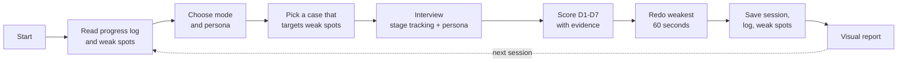

<!-- Claude: the interviewer instructions live in INSTRUCTIONS.md. Read that file and follow it to run a session. This README is for humans. -->

# PM Interview Practice

**Turn Claude into a strict mock PM interviewer that runs the interview, scores you, remembers your progress, and gives you a visual report after every session.**

You answer out loud, by voice. Claude plays the interviewer. It tracks which stage of the framework you're in, sticks to the case, applies an interviewer persona, and scores you on a 7-dimension rubric with evidence quotes from your own answer. Every session is saved, so the next one targets your weak spots.

No app, no backend, no code. It's a folder of well-written Markdown files that Claude reads.

> **Phase 1:** Product Sense interviews. The structure is built so you can add RCA, metrics, strategy or behavioral rounds by copying the same pattern.

---

## Contents
- [About me](#about-me)
- [What you get](#what-you-get)
- [How it works](#how-it-works)
- [Folder structure](#folder-structure)
- [Setup (Claude Desktop)](#setup-claude-desktop)
- [How to use it](#how-to-use-it)
- [Sample reports](#sample-reports)
- [Customize and extend](#customize-and-extend)
- [Upgrading to the latest version](#upgrading-to-the-latest-version)
- [Contributing](#contributing)
- [Credits](#credits)

---

## About me

Hi, I'm **Lokendra**, a Product Manager with **8 years of experience** across edtech, fintech, agritech and SaaS. Across those roles I've driven about **$5M in revenue impact**.

- **Now:** AI Product Manager at **Storable**, leading the only AI team in the organization. We're building AI-powered products for the US self-storage industry. I launched a new product that has reached **$30K MRR**, and I'm now laying the foundation to scale AI across the company, turning experimentation into systems that drive real business impact.
- **Upskilling as an AI Engineer.** I believe the next wave of product leaders will combine product thinking with hands-on AI execution. I'm on a 90-day challenge to learn, build and ship practical AI solutions. This repo is one of them.
- **Agritech, Gates Foundation-funded:** helped build an AI-powered vernacular voice system that answers farmers' queries. The work took me to remote parts of Bihar and taught me what understanding users at the grassroots really means.
- **Edtech:** built and scaled sales and operations teams, contributing an additional **$1M in revenue**.
- **Early career:** started in agritech as a growth professional, helping scale the team to 30+ people and supporting the distribution of **$250K in loans**.

My path wasn't conventional: I wanted to be an actor, moved into advertising, then into product and startups. I've also built **two startups that didn't take off**. They taught me more about execution, resilience and building from scratch than any success could have.

I'm always up for conversations about AI, product, and building things that matter.

### Want help breaking into PM?
I run **mock PM interviews** and **1:1 sessions to help you break into a PM role**: interview prep, case practice, resume and positioning.

👉 **Book a session: [topmate.io/prodcodebyloki](https://topmate.io/prodcodebyloki)**

---

## What you get

| Feature | What it means |
|---|---|
| 🎙️ **Voice-first mock interviews** | Speak your answers; Claude responds like a real interviewer, with short turns and one question at a time. |
| 🧭 **Live stage tracking** | Every turn shows where you are, for example `[Stage 2: Segmentation]`, including skipped stages. |
| 🎭 **3 interviewer personas** | Friendly, Neutral (realistic default) and Skeptical (pushback, silence tests, curveballs). |
| 📏 **Strict, evidence-based scoring** | 7 dimensions scored 1-5. A 3 is competent and a 5 is rare. Every score carries a verbatim quote from your answer. |
| 🔁 **Redo loop** | Redo your weakest 60 seconds and compare both attempts side by side. |
| 🧠 **Memory across sessions** | A progress log and a ranked weak-spots list steer which case you get next. |
| 📊 **Visual report** | Overall rating, scores chart, strengths and weaknesses, work summary, improvement plan, time per stage, and a trend over sessions. |
| 🧩 **Easy to extend** | New case = copy a template. New question type = add a framework, a rubric and cases. |

### Three modes
- **Mock:** a full interview with no help, scored at the end. Hints are allowed, but they cost you.
- **Coach:** work the case together, pausing at each stage to discuss what you'd do and why.
- **Teardown:** Claude walks through a strong model answer with commentary.

---

## How it works



### The framework stages
| Stage | What you prove | Target time |
|---|---|---|
| 0 Communication | You lead with structure: restate, set assumptions, give a game plan | 3-5 min |
| 1 Product motivation | You understand why the product exists; you state a mission | 3-5 min |
| 2 Segmentation | Ecosystem → 3 motivation-based segments → 2x2 → persona | 8-10 min |
| 3 Problem identification | Journey → 3 problems → severity × frequency → pick one | 8-10 min |
| 4 Solutions | 3 distinct ideas → impact vs. effort → v1 → risks | 8-10 min |
| 5 Success metrics | North star, guardrails, how to evaluate | ~3 min |
| Closing | Tie it back to the mission | ~1 min |

### The rubric (7 dimensions, scored 1-5)
D1 Clear communication · D2 Product motivation · D3 Segmentation · D4 Problem identification · D5 Solution brainstorming · D6 Solution selection & v1 · D7 Success metrics & risks

**Pass** requires every dimension to be ≥ 3. Brilliance in one area can't rescue weakness in another, just like real interview loops.

### Ground rules Claude follows
- It never reveals the rubric, framework hints or model answer during a mock.
- It asks **only** questions written in the case file (opening question, follow-ups, curveballs). No invented scenarios.
- It never praises without evidence, and it rewards adapting the framework to the case, not reciting it.
- Time per stage is **estimated** from answer length. Claude says so and never fakes precision.

---

## Folder structure

```
pm-interview-practice/
├── README.md                    ← you are here (for humans)
├── INSTRUCTIONS.md              ← master instructions Claude follows every session
├── frameworks/
│   └── product-sense.md         ← the stages you're expected to follow
├── rubrics/
│   └── product-sense.md         ← scoring: 7 dimensions with 1/3/5 anchors and failure modes
├── personas/
│   ├── friendly.md              ← warm, no curveballs
│   ├── neutral.md               ← realistic default
│   └── skeptical.md             ← pushback, silence test, curveballs
├── cases/product-sense/
│   ├── case-01.md               ← Rippling: AI usage tracking, provisioning and ROI
│   └── _case-template.md        ← copy this to add a case
├── sessions/
│   └── _session-template.md     ← format of each saved session
├── reports/
│   └── _report-template.html    ← visual report (Claude fills in the data block only)
├── my-context/                  ← optional: resume.md, target-role.md (git-ignored)
├── docs/sample-reports/         ← screenshots for this README
├── _progress-log-template.md     ← blank log; Claude copies it to progress-log.md on first run
└── _weak-spots-template.md       ← blank weak-spots list; copied to weak-spots.md on first run
```

| File type | Role |
|---|---|
| **Framework** | Defines the stages Claude tracks. |
| **Rubric** | Defines how each dimension is scored, what evidence to quote, and common failure modes. |
| **Case** | Opening question, facts to reveal only if asked, facts to hold back, follow-up questions per stage, curveballs, and a model answer (used only in teardown mode and the debrief). |
| **Persona** | Tone, interruptions, reactions and curveball count. Personas never decide question content. |
| **Logs** | Your history. They drive case selection and focus areas. |

---

## Setup (Claude Desktop)

Takes about 5 minutes.

### 1. Get the files
```bash
git clone https://github.com/<github-username>/pm-interview-practice.git
```
Or click **Code → Download ZIP** and unzip it somewhere permanent, for example `~/Documents/pm-interview-practice`.

### 2. Give Claude Desktop access to the folder
Claude needs to **read and write** this folder to save sessions and update your progress.

- Open **Claude Desktop → Settings → Extensions**, install **Filesystem**, and add the `pm-interview-practice` folder as an allowed directory.
- **No Extensions menu?** Use the config file instead. Go to **Settings → Developer → Edit Config** and add the block below (this needs Node.js). Then restart Claude Desktop.

```json
{
  "mcpServers": {
    "filesystem": {
      "command": "npx",
      "args": ["-y", "@modelcontextprotocol/server-filesystem",
               "/absolute/path/to/pm-interview-practice"]
    }
  }
}
```

### 3. Create a Project
**Projects → New Project**, for example "PM Interview Practice". Paste this into the project's **custom instructions**, using your real path:

```
At the start of every chat, use the filesystem tool to read
/absolute/path/to/pm-interview-practice/INSTRUCTIONS.md and follow it exactly.
Read and write all practice files in that folder. Never rely on uploaded copies.
```

> Don't upload the files as project knowledge. Uploaded copies are read-only and go stale; the extension reads the live files.

### 4. (Optional) Add your context
Create `my-context/resume.md` and `my-context/target-role.md`. They're git-ignored, so they stay private.

**Can't give file access?** Claude will still run the interview. At the end it prints the updated files in the chat for you to save yourself.

> **Claude Code works too:** run `claude` inside the folder and say "Read INSTRUCTIONS.md and start a session."

---

## How to use it

1. Open the Project and start a **new chat for each session**, so earlier sessions don't influence this one.
2. Say **"Start a session"**, or be specific: **"Mock, skeptical, go."**
3. When Claude first asks to read or write files, choose **Allow always** for that chat.
4. Answer **by voice**: use the mic in the message box if your version has one, or macOS dictation (System Settings → Keyboard → Dictation).
5. Say **"That's time"** when you're done. You'll get scores, the redo loop, a saved session and the visual report.

### Useful commands
| Say | What happens |
|---|---|
| `Start a session` | Uses the defaults: mock mode, neutral persona, auto-picked case |
| `Coach mode on case-01` | Works the case together, stage by stage |
| `Teardown case-01` | Walks through the model answer |
| `Hint` | One-sentence hint. It's counted, and it caps that dimension at 3 |
| `Show my report` / `Progress report` | Rebuilds the visual report with your full history |
| `How am I trending?` | Summarizes `weak-spots.md` |

### What gets saved
- `sessions/YYYY-MM-DD-case-NN.md`: the full session record
- `sessions/YYYY-MM-DD-case-NN-report.html`: the visual report (open it in any browser)
- A new row in `progress-log.md`, and a rebuilt `weak-spots.md`

> 🔒 **All session data is git-ignored.** Session files, reports, `progress-log.md`, `weak-spots.md` and `my-context/` stay on your machine and are never pushed, even if you fork and commit.

---

## Sample reports

<!--
  Add screenshots to docs/sample-reports/ (see docs/sample-reports/README.md for sizes),
  then uncomment the block below.

<p align="center">
  
</p>
<p align="center">
  
</p>
<p align="center">
  
</p>
-->

_Sample reports coming soon._

Each report includes:
- the overall rating and verdict
- a work summary
- a D1-D7 scores chart with evidence quotes
- strengths and weaknesses
- a 3-step improvement plan
- time per stage vs. target
- a redo comparison
- your score trend across sessions

---

## Customize and extend

### Add a case
1. Copy `cases/product-sense/_case-template.md` to `case-02.md`.
2. Fill in every field: the opening question, reveal-if-asked facts, hold-back facts, **follow-up questions per stage** (the only questions the interviewer may ask), curveballs, and **Skills tested** (for example `D3, D7`, used to target weak spots).
3. That's it. Claude picks it up next session.

### Add a persona
Copy any file in `personas/` and change the tone, interruptions, reactions to weak and strong answers, silence behavior and curveball count. Personas set *how* the interviewer behaves, never *what* it asks.

### Add a question type (RCA, metrics, strategy, behavioral…)
Add three things. The session flow in `INSTRUCTIONS.md` works unchanged:
```
frameworks/rca.md
rubrics/rca.md
cases/rca/case-01.md
```
Then say "Start an RCA session."

### Tune the scoring
Edit `rubrics/product-sense.md` to change anchors, failure modes, or rules such as the hint cap and the pass threshold.

---

## Upgrading to the latest version

All your personal data is git-ignored, so upgrading never touches it or conflicts with it:
- `sessions/` (session files and reports)
- `progress-log.md`
- `weak-spots.md`
- `my-context/`

**If you cloned with git:**
```bash
cd pm-interview-practice
git pull origin main
```
If you've edited tracked files (for example your own cases or rubric tweaks), run `git stash` first and `git stash pop` after.

**If you forked:** add the original repo as `upstream` once, then pull from it:
```bash
git remote add upstream https://github.com/<github-username>/pm-interview-practice.git
git pull upstream main
```

**If you downloaded a ZIP:** download the new ZIP, then copy your `sessions/`, `my-context/`, `progress-log.md`, `weak-spots.md` and any cases you added into the new folder.

After upgrading, nothing else changes. Claude reads the updated `INSTRUCTIONS.md` at the start of your next chat.

---

## Contributing

**Please raise pull requests!** This is meant to be a living practice system, and it gets better with every interviewer's and candidate's experience. If you find a gap in the workflow, a rubric anchor that feels off, or a persona that doesn't feel real, open a PR.

Contributions I'd love:
- 🗂️ **New cases.** Follow `_case-template.md`, and include follow-up questions and curveballs.
- 🧩 **New question types.** RCA, metrics, product strategy, behavioral, estimation: a framework, a rubric and at least one case.
- 🎭 **New personas.** For example "FAANG bar-raiser" or "startup founder".
- 📏 **Rubric improvements.** Sharper 1/3/5 anchors and failure modes.
- 🔧 **Workflow fixes.** Anything that makes sessions more realistic or reports more useful.
- 📊 **Report upgrades** to `reports/_report-template.html`. Keep it a single self-contained file.

**How to contribute**
1. Fork the repo and create a branch: `git checkout -b add-rca-framework`
2. Make your change, keeping files concise and in plain Markdown.
3. Do a quick dry run in Claude Desktop to check it behaves as intended.
4. Open a pull request describing **what** you changed and **why**, plus a short transcript snippet if it changes interviewer behavior.

**Guidelines**
- Don't commit personal data (resumes, real session transcripts, employer details).
- Only add case content you wrote yourself or have the right to share.
- Keep `INSTRUCTIONS.md` readable in about 5 minutes. Put details in the framework, rubric or case files.

Not ready for a PR? **Open an issue** with your idea or the problem you hit.

---

## Credits
- The product sense framework is distilled from **Ben Erez's** product sense guide in **Lenny's Newsletter**, expanded into an action-oriented playbook.
- The Rippling case uses general public knowledge. All numbers are illustrative.

---

<p align="center">
  Built by <b>Lokendra</b> · Mock interviews and PM coaching: <a href="https://topmate.io/prodcodebyloki">topmate.io/prodcodebyloki</a>
</p>
